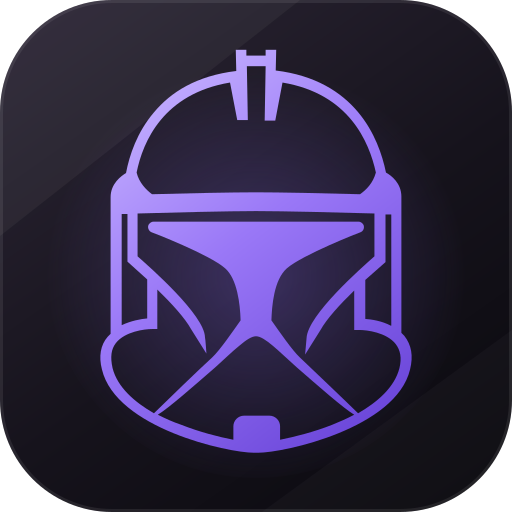
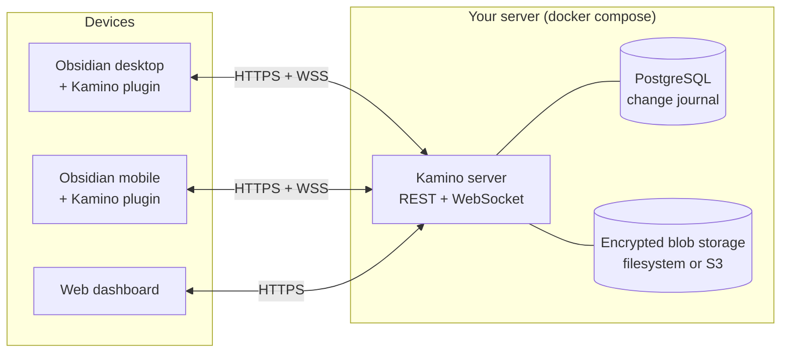

<div align="center">



# Kamino

**Self-hosted sync for your Obsidian vaults: real-time, encrypted at rest, and conflicts you actually understand.**

Your notes, every device, your server. No subscriptions, no black boxes, no silent failures.

<p>
  
  <a href="LICENSE"></a>
  
  
  
  
</p>

[Why Kamino](#why-kamino) · [Features](#features) · [How it works](#how-it-works) · [Quick start](#quick-start) · [Roadmap](#roadmap) · [Docs](#documentation)

</div>

> [!WARNING]
> **Kamino is in early development (milestone M0).** The foundations are being laid and sync does not work yet. Star or watch the repo to follow along, and don't trust it with your only copy of a vault until 1.0 ships.

---

## Why Kamino

Kamino began with a vault that was lost.

A self-hosted sync server stopped working without telling anyone. A fresh Windows install later, the vault could not be recovered. Git worked on desktop but was painful on mobile. The popular sync plugins were fiddly to configure, and when two devices disagreed you were left guessing which version would survive.

Kamino is built around one promise:

> **You never lose anything, and you always know whether you're safe.**

## Features

|                                 |                                                                                                                                                                                                            |
| ------------------------------- | ---------------------------------------------------------------------------------------------------------------------------------------------------------------------------------------------------------- |
| ⚡ **Near real-time sync**      | Changes reach connected devices within seconds over WebSocket. Offline devices catch up the moment they reconnect, whether they were gone for minutes or months.                                           |
| 🚨 **No silent failures**       | Every device shows when it last synced and how many changes haven't reached the server yet. If something stalls, Kamino warns you persistently.                                                            |
| 🧭 **Conflicts you can read**   | When two devices edit the same note, you see what's coming in next to your own version, then keep yours, take theirs, or keep both. You can do this right inside Obsidian. No version is ever thrown away. |
| 📱 **Pair a phone in seconds**  | Scan a QR code or tap a magic link. The device that created the link confirms the pairing with a short verification code. There are no config files to copy around.                                        |
| 🔐 **Encrypted at rest**        | File contents, paths and vault names are encrypted with per-vault keys wrapped by a master key that never touches the database. A stolen database dump or storage bucket is useless on its own.            |
| 🙈 **Admins can't peek**        | Kamino is multi-user and each user sees only their own vaults. Admins manage users and quotas but never see note names or contents, in the UI or in the API.                                               |
| 🗄️ **Safety net built in**      | A mandatory 7-day trash, per-vault version history of up to 90 days, a ZIP export of any vault (even "as it was on date X"), and the ability to rebuild the server from any device.                        |
| 🎛️ **Sync your way**            | Live, periodic or manual sync per device. Optional, per-category sync of `.obsidian` settings. Large attachments can be limited to Wi-Fi only.                                                             |
| 🐳 **One command to self-host** | `docker compose up` gives you two containers: the app and Postgres. Reference setups cover LAN, Tailscale, Cloudflare Tunnel and Caddy with Let's Encrypt.                                                 |
| 🌍 **Built to be shared**       | English and Italian out of the box, light and dark themes, SemVer releases, and every major and minor release named after a famous clone.                                                                  |

## How it works



- **A change journal instead of a black box.** Every accepted change gets a sequence number in an append-only journal per vault. Each device remembers the last number it applied, so it can always ask for everything after N. The server always knows exactly how far behind each device is.
- **Whole-file versions with stable identity.** Renames and moves keep a file's history. Every change records the version it was based on, so conflicts are detected reliably, and automatic three-way merge can come later without changing the protocol.
- **Idempotent by design.** Every operation can be retried safely. A change counts as "synced" only after the server confirms it is stored durably.
- **Envelope encryption.** A per-vault data key, wrapped by a master key you provide as a Docker secret. If the key is wrong, the server refuses to start rather than corrupting anything.

Want the details? Read the [sync protocol](docs/03-sync-protocol.md) and the [threat model](docs/04-security-threat-model.md).

## Quick start

> [!NOTE]
> These commands start the server foundations: health checks, version endpoint and master-key verification. Sync itself lands in milestones M1 and M2.

```bash
git clone https://github.com/davidemaggi/Kamino.git
cd Kamino

# 1. Configure: set KAMINO_DB_PASSWORD (URL-safe characters only) in docker/.env
cp docker/.env.example docker/.env

# 2. Build the image and generate a master key; keep a copy somewhere safe and offline
docker build -f docker/Dockerfile -t kamino:local .
mkdir -p docker/secrets
docker run --rm kamino:local keys generate > docker/secrets/kamino_master_key
# Windows PowerShell 5.1: use  | Out-File -Encoding ascii  instead of  >  (see docs/self-hosting.md)

# 3. Start Kamino + Postgres
docker compose -f docker/compose.lan.yml up -d

# 4. Check it's alive
curl http://localhost:8080/health/ready
curl http://localhost:8080/version
```

See [docs/self-hosting.md](docs/self-hosting.md) for Tailscale, Cloudflare Tunnel and Caddy + Let's Encrypt setups.

> [!IMPORTANT]
> **Guard your master key.** Without it, the data on the server cannot be recovered. That is by design: it is what makes a stolen dump useless. Your devices still hold their copies, and Kamino can rebuild a server from any of them.

## Kamino vs. the alternatives

|                                          |    Kamino    |   Git-based sync   | CouchDB-based plugins |   Obsidian Sync   |
| ---------------------------------------- | :----------: | :----------------: | :-------------------: | :---------------: |
| Self-hosted                              |      ✅      |         ✅         |          ✅           |        ❌         |
| Free                                     |      ✅      |         ✅         |          ✅           | ❌ (subscription) |
| Real-time                                |      ✅      |         ❌         |          ✅           |        ✅         |
| Painless on mobile                       |      ✅      |         ❌         |          ⚠️           |        ✅         |
| Side-by-side conflict resolution         |      ✅      | ⚠️ (merge markers) |          ⚠️           |        ⚠️         |
| Multi-user, with admins blind to content |      ✅      |         ❌         |          ⚠️           |        n/a        |
| Pair a device by QR                      |      ✅      |         ❌         |          ⚠️           |        ❌         |
| End-to-end encryption                    | ❌ (at rest) |         ⚠️         |          ✅           |        ✅         |

Kamino deliberately chooses **encryption at rest over end-to-end encryption**. The server can read your notes, which is what makes the web diff view, ZIP export and future server-side merge possible. A database or storage dump on its own is still useless. If you need protection from the person running the server, an E2EE tool is the better fit.

## Roadmap

| Milestone | What it brings                                                                              | Status         |
| --------- | ------------------------------------------------------------------------------------------- | -------------- |
| **M0**    | Monorepo, CI, Docker, server foundations, master-key verification, plugin and web skeletons | 🚧 in progress |
| **UI**    | Design system and screens                                                                   | ⏳             |
| **M1**    | Single-device sync: upload a vault, get it back intact                                      | ⏳             |
| **M2**    | Multi-device real-time sync, sync modes, `.obsidian` categories                             | ⏳             |
| **M3**    | Conflicts, trash and version history                                                        | ⏳             |
| **M4**    | User web dashboard: devices, conflicts, ZIP export, 2FA                                     | ⏳             |
| **M5**    | Admin, quotas, email/SMTP                                                                   | ⏳             |
| **M6**    | QR code and magic-link pairing                                                              | ⏳             |
| **M7**    | Hardening, backups, key rotation → **1.0.0 "Ash"**                                          | ⏳             |

Full plan: [docs/06-roadmap.md](docs/06-roadmap.md).

### Release names

Every MAJOR and MINOR release is named after a famous clone. The first letter follows the major version: 1.x is A, 2.x is B, and so on. Everything up to and including 1.0 is called **Ash**, after _Alien_. After that come names like Alison, Boba, Cody, Dolly… See [docs/release-names.md](docs/release-names.md).

## Tech stack

**TypeScript (strict) everywhere.** The monorepo uses pnpm and Turborepo.

- **Server:** Fastify, Drizzle ORM, PostgreSQL and pg-boss.
- **Web:** React, Vite, Tailwind, shadcn/ui, TanStack Query and react-i18next.
- **Plugin:** the Obsidian API, built with esbuild. It runs on mobile, with no Node or Electron APIs.
- **Tests:** Vitest, fast-check, Playwright and Testcontainers.

```
apps/server     API, WebSocket, jobs, crypto
apps/web        web dashboard
apps/plugin     Obsidian plugin
packages/       shared protocol, sync logic, branding
docs/           design docs and ADRs
```

## Documentation

The design docs are in Italian.

[Vision](docs/00-vision.md) · [Requirements](docs/01-requirements.md) · [Architecture](docs/02-architecture.md) · [Sync protocol](docs/03-sync-protocol.md) · [Threat model](docs/04-security-threat-model.md) · [Data model](docs/05-data-model.md) · [Roadmap](docs/06-roadmap.md) · [Glossary](docs/glossary.md) · [ADRs](docs/adr/)

## Development

Requires Node ≥ 22.12 (24 LTS recommended), pnpm 10 and Docker for the integration tests.

```bash
pnpm install
pnpm build
pnpm test        # Vitest; DB tests spin up Postgres via Testcontainers
pnpm lint && pnpm typecheck
```

Conventions (Conventional Commits, changesets, TDD) are described in [CLAUDE.md](CLAUDE.md).

## Contributing

Kamino is still taking shape. Issues, ideas and feedback are very welcome. Larger pull requests are best discussed in an issue first, while the foundations settle.

## License

[MIT](LICENSE) © Davide Maggi

---

<div align="center">
<sub>"Kamino" is a code name. The public name may change before 1.0. Not affiliated with Obsidian or Lucasfilm.</sub>
</div>
