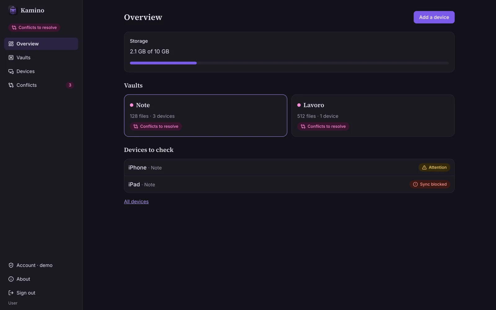
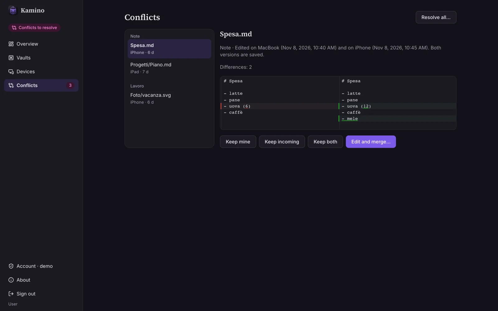
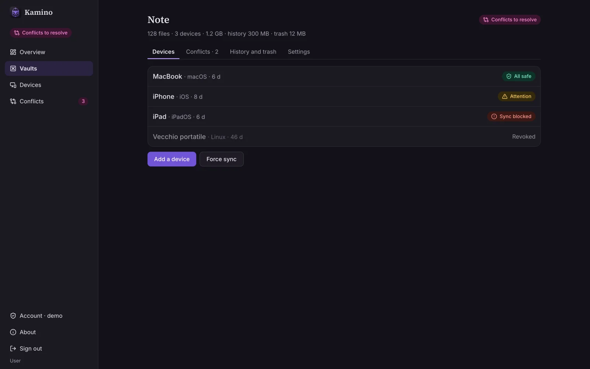
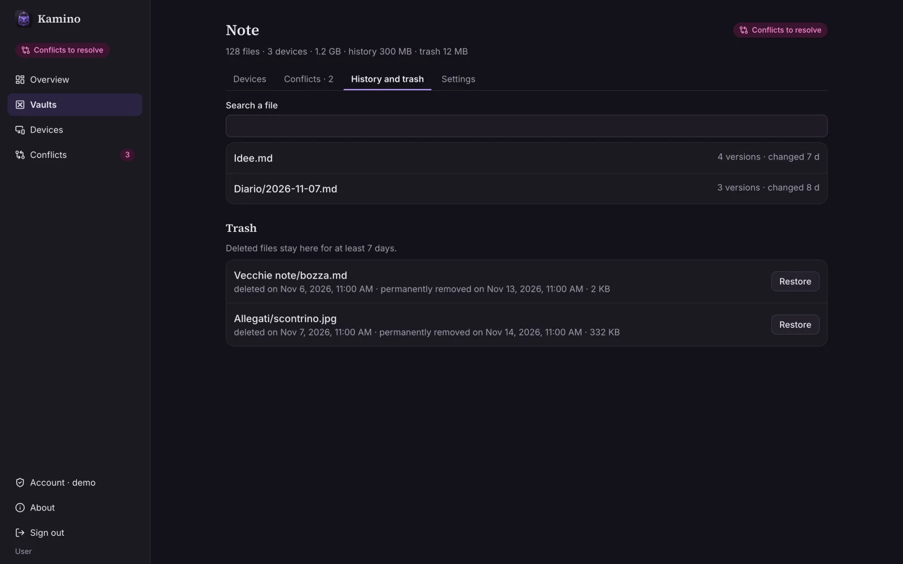
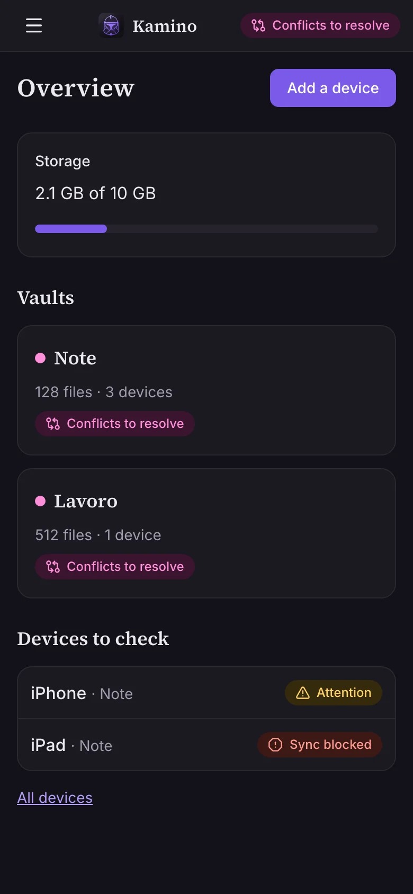
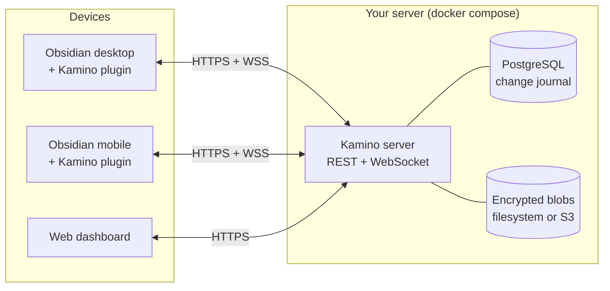

<div align="center">


# Kamino

### Your Obsidian vaults, on every device, on your own server.

Self-hosted sync for Obsidian with near real-time updates, encryption at rest, and conflicts you can actually read.<br/>
**You never lose anything, and you always know whether you're safe.**

<p>
  <a href="https://github.com/davidemaggi/Kamino/releases/latest"></a>
  <a href="https://github.com/davidemaggi/Kamino/pkgs/container/kamino"></a>
  
  <a href="LICENSE"></a>
  
</p>

[Quick start](#-quick-start) · [Features](#-features) · [Screenshots](#-a-quick-tour) · [How it works](#-how-it-works) · [Comparison](#-kamino-vs-the-alternatives) · [Docs](#-documentation)

<br/>



</div>

---

## 💡 Why Kamino

Kamino started with a vault that was lost.

A self-hosted sync server stopped working and didn't tell anyone. After a fresh Windows install, the vault couldn't be recovered. Git worked on the desktop but was a pain on the phone. The popular sync plugins were fiddly to set up, and when two devices disagreed, you had to guess which version would survive.

So Kamino makes one promise and builds everything around it: **nothing is ever thrown away, and the state of every device is always visible.** If a device falls behind, you see it. If two edits collide, you keep both and choose with a diff in front of you. If you delete something by mistake, it waits in the trash.

## ✨ Features

|                                |                                                                                                                                                                                             |
| ------------------------------ | ------------------------------------------------------------------------------------------------------------------------------------------------------------------------------------------- |
| ⚡ **Near real-time sync**     | Changes reach your other devices within seconds over WebSocket. A device that was offline for minutes or for months catches up as soon as it reconnects.                                    |
| 🚨 **No silent failures**      | Every device shows when it last synced and how many changes are still waiting to reach the server. If something stalls, Kamino keeps warning you until it's fixed.                          |
| 🧭 **Conflicts you can read**  | When two devices edit the same note, you see both versions side by side. Keep yours, take theirs, keep both, or merge them by hand, in Obsidian or in the browser.                          |
| 🗄️ **A safety net, built in**  | Every deleted file stays in the trash for at least 7 days, and each vault keeps up to 90 days of history. You can also export any vault as a ZIP, as it is now or as it was on a past date. |
| 📱 **Pair a phone in seconds** | Scan a QR code or open a link. The device that made the link confirms the pairing with a short code, so there are no config files to copy around.                                           |
| 🔐 **Encrypted at rest**       | File contents, paths and vault names are encrypted with per-vault keys, wrapped by a master key that never touches the database. A stolen dump or bucket is useless on its own.             |
| 🙈 **Admins can't peek**       | Multi-user from day one. Admins manage users, quotas and email, but they never see a note's name or contents, in the UI or in the API.                                                      |
| 🎛️ **Sync your way**           | Choose live, periodic or manual sync for each device. Large attachments can wait for Wi-Fi. `.obsidian` settings can sync category by category if you opt in.                               |
| 🐳 **One compose file**        | Two containers: Kamino and Postgres. The image runs on amd64 and arm64, so a Raspberry Pi works. Ready-made setups cover LAN, Tailscale, Cloudflare Tunnel and Caddy.                       |
| 🌍 **Polished, everywhere**    | A web dashboard with 2FA, light and dark themes, English and Italian, and a plugin that runs the same on desktop, iOS and Android.                                                          |

## 📸 A quick tour

<table>
  <tr>
    <td width="50%"><br/><sub><b>Conflicts, side by side.</b> Both versions are saved; you pick or merge.</sub></td>
    <td width="50%"><br/><sub><b>Every device, every state.</b> All safe, needs attention, or blocked, at a glance.</sub></td>
  </tr>
  <tr>
    <td width="50%"><br/><sub><b>History and trash.</b> Bring back any version or any deleted file.</sub></td>
    <td width="50%" align="center"><br/><sub><b>Works on the phone, too.</b> The dashboard adapts to any screen.</sub></td>
  </tr>
</table>

## 🚀 Quick start

You need a machine with Docker. Your phones also need **HTTPS**: Tailscale, Cloudflare Tunnel or a domain with Caddy all work, and [the self-hosting guide](docs/self-hosting.md) covers each one.

**1. Grab two files** into an empty folder:

```bash
curl -fsSLO https://raw.githubusercontent.com/davidemaggi/Kamino/main/docker/compose.image.yml
curl -fsSL  https://raw.githubusercontent.com/davidemaggi/Kamino/main/docker/image.env.example -o .env
```

**2. Fill in `.env`.** Set `KAMINO_PUBLIC_URL` and `KAMINO_DB_PASSWORD`, then generate the master key:

```bash
docker run --rm ghcr.io/davidemaggi/kamino:latest keys generate   # paste the output into KAMINO_MASTER_KEY
```

**3. Start it** and open the setup link to create the first admin:

```bash
docker compose -f compose.image.yml up -d
docker compose -f compose.image.yml logs kamino | grep setup
```

> [!IMPORTANT]
> **Keep a copy of the master key somewhere off the server**, for example in a password manager. Without it, the data on the server can't be read. That is on purpose: it's what makes a stolen dump useless. Your devices still keep their own copies, so nothing is lost.

### Install the plugin

Until Kamino is listed in the Obsidian community store, install it with [BRAT](https://github.com/TfTHacker/obsidian42-brat):

1. In Obsidian, go to **Settings → Community plugins → Browse**, then install and enable **BRAT**.
2. Run **BRAT: Add a beta plugin for testing** and paste `davidemaggi/Kamino`.
3. Enable Kamino, open its settings, enter your server address and sign in. To add more devices, use a QR code or a pairing link.

> [!NOTE]
> The plugin needs a Kamino server and an account on it. It talks only to the server you configure: no telemetry, no third parties.

## 🔧 How it works



- **A change journal, not a black box.** Every accepted change gets a sequence number in an append-only journal for its vault. Each device remembers the last number it applied, so it can always ask "what's new since N?", and the server always knows how far behind each device is.
- **Versions with a stable identity.** Renames and moves keep a file's history. Every change states which version it was based on, so conflicts are detected reliably and never resolved by silently overwriting.
- **Safe to retry.** Every operation is idempotent. A change counts as synced only after the server confirms it's stored durably.
- **Envelope encryption.** Each vault has its own data key, wrapped by a master key you provide. If the key is wrong, the server refuses to start rather than corrupting anything.

Want the details? Read the [sync protocol](docs/03-sync-protocol.md) and the [threat model](docs/04-security-threat-model.md).

## ⚖️ Kamino vs. the alternatives

|                                          |    Kamino    |   Git-based sync   | CouchDB-based plugins |   Obsidian Sync   |
| ---------------------------------------- | :----------: | :----------------: | :-------------------: | :---------------: |
| Self-hosted                              |      ✅      |         ✅         |          ✅           |        ❌         |
| Free                                     |      ✅      |         ✅         |          ✅           | ❌ (subscription) |
| Near real-time                           |      ✅      |         ❌         |          ✅           |        ✅         |
| Painless on mobile                       |      ✅      |         ❌         |          ⚠️           |        ✅         |
| Side-by-side conflict resolution         |      ✅      | ⚠️ (merge markers) |          ⚠️           |        ⚠️         |
| Multi-user, with admins blind to content |      ✅      |         ❌         |          ⚠️           |        n/a        |
| Pair a device with a QR code             |      ✅      |         ❌         |          ⚠️           |        ❌         |
| End-to-end encryption                    | ❌ (at rest) |         ⚠️         |          ✅           |        ✅         |

Kamino deliberately uses **encryption at rest instead of end-to-end encryption**. The server can read your notes, and that's what makes the browser diff view, ZIP exports and server-side checks possible. A database or storage dump on its own is still useless. If you need protection from whoever runs the server, an end-to-end encrypted tool is a better fit.

## 🏷️ Release names

Every major and minor release is named after a famous clone, and the first letter follows the major version: 1.x starts with A, 2.x with B. **1.0 is "Ash"**, after _Alien_. Next up: Alison, Boba, Cody, Dolly… See [docs/release-names.md](docs/release-names.md).

## 📚 Documentation

- **Running a server:** [Self-hosting guide](docs/self-hosting.md), covering LAN, tunnels, Caddy, backups, key rotation, updates and diagnostics.
- **Design docs** (in Italian): [Vision](docs/00-vision.md) · [Requirements](docs/01-requirements.md) · [Architecture](docs/02-architecture.md) · [Sync protocol](docs/03-sync-protocol.md) · [Threat model](docs/04-security-threat-model.md) · [Data model](docs/05-data-model.md) · [Roadmap](docs/06-roadmap.md) · [ADRs](docs/adr/)

## 🛠️ Development

TypeScript (strict) everywhere, in a pnpm + Turborepo monorepo:

- **Server:** Fastify, Drizzle, PostgreSQL and pg-boss.
- **Web:** React, Vite, Tailwind, TanStack Query and react-i18next.
- **Plugin:** the Obsidian API only, built with esbuild, with no Node or Electron APIs so it runs on mobile.
- **Tests:** Vitest, fast-check (property-based sync tests), Playwright and Testcontainers.

```bash
pnpm install
pnpm build
pnpm test                          # integration tests start Postgres with Testcontainers (needs Docker)
pnpm --filter @kamino/web dev      # dashboard with fake data at http://localhost:5173
```

Requires Node ≥ 22.12 and pnpm 10. Conventions (Conventional Commits, changesets, TDD) are in [CLAUDE.md](CLAUDE.md).

## 🤝 Contributing

Bug reports, ideas and pull requests are welcome. For anything larger than a small fix, please open an issue first so we can agree on the approach. If sync ever misbehaves, the plugin's **Copy diagnostics** command produces a report with no file names or contents, ready to paste into an issue.

## 📄 License

[AGPL-3.0](LICENSE) © Davide Maggi. You can use, modify and self-host Kamino freely. If you offer a modified version as a service, you must share its source code.

---

<div align="center">
<sub>Not affiliated with Obsidian or Lucasfilm.</sub>
</div>
